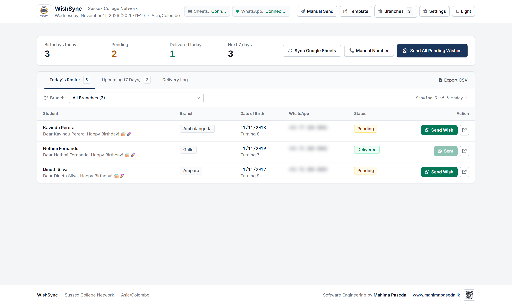
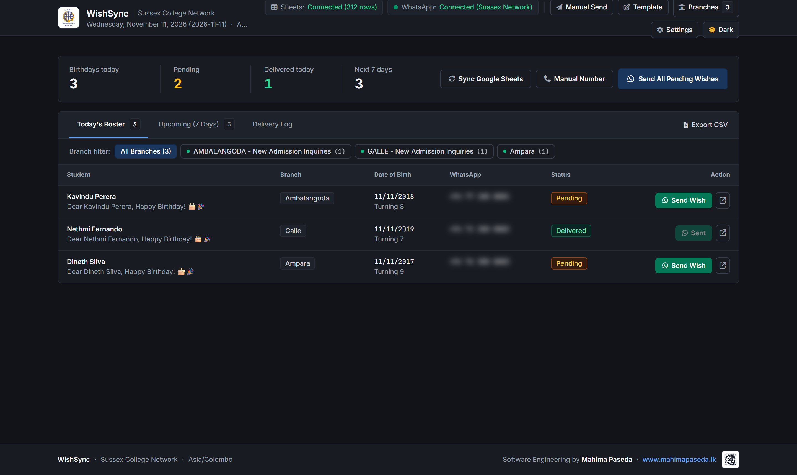
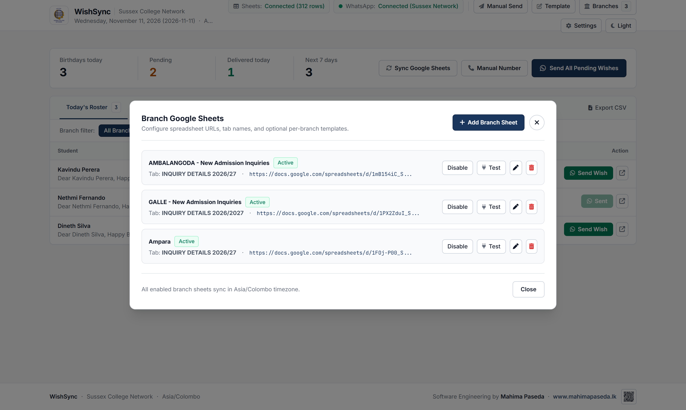
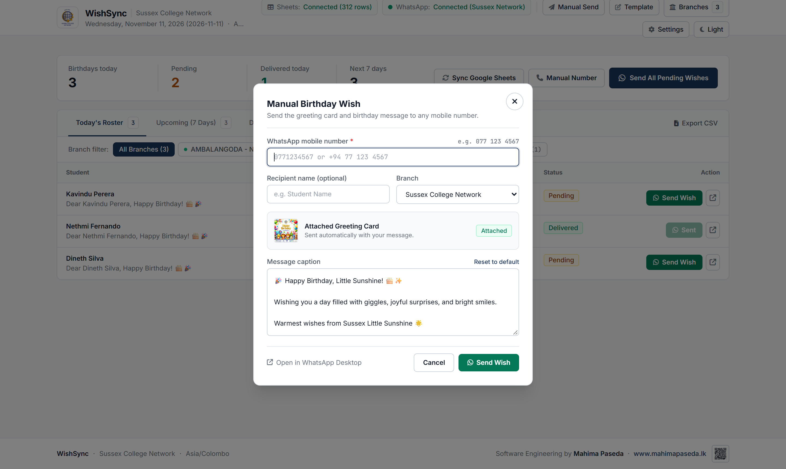
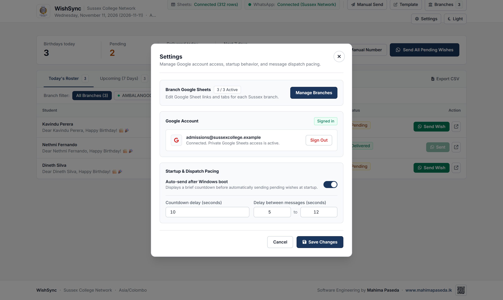

<div align="center">
  
  <h1>WishSync</h1>
  <p><strong>Automated Birthday Dispatch Desktop Software for Google Sheets &amp; WhatsApp</strong></p>
  <p>Built for the <strong>Sussex College Network</strong> &bull; Lightweight 4GB-RAM Windows Startup Edition (<code>v1.0.4</code>)</p>

  <p>
    
    
    
    
  </p>
</div>

---

## Interface Showcase

### Main Operations Workbench — Light Mode (Default) & Dark Mode

<p align="center">
  
</p>

<details>
<summary>View Dark Mode Dashboard</summary>
<br />
<p align="center">
  
</p>
</details>

### Key Dialogs & Workflows

<table>
  <tr>
    <td align="center" width="50%">
      <strong>Multi-Branch Google Sheets Manager</strong><br /><br />
      
      <sub>Manage multiple branch spreadsheets, sheet tabs, enable/disable toggles, and per-branch templates.</sub>
    </td>
    <td align="center" width="50%">
      <strong>Manual Birthday Wish Dispatch</strong><br /><br />
      
      <sub>Send the greeting card image and birthday caption directly to any mobile number on demand.</sub>
    </td>
  </tr>
  <tr>
    <td align="center" colspan="2">
      <strong>Settings, Google Account & Startup Dispatch Pacing</strong><br /><br />
      <br />
      <sub>One-click Google Sign-In, Windows boot auto-send delay, and randomized anti-ban dispatch intervals.</sub>
    </td>
  </tr>
</table>

---

## Core Capabilities

- **Multi-Branch Google Sheets Sync**: Reads live student rosters across multiple branch spreadsheets (`AMBALANGODA`, `GALLE`, `Ampara`, and custom branches) with single-flight request deduplication and Asia/Colombo (`UTC+05:30`) date matching.
- **Google OAuth Desktop Sign-In**: Connects securely to private Google Sheets via Google OAuth (`wishsync://auth-success` deep-link callback) with persistent encrypted/local token storage in user app data.
- **Automated WhatsApp Media Dispatch**: Sends personalized birthday captions paired with the official greeting card graphic via `whatsapp-web.js` (with randomized min/max pacing between recipients) or manual `wa.me` / WhatsApp Desktop fallback.
- **Zero Duplicate Wishes**: Tracks every sent delivery in a local JSON ledger (`data/sent_log.json` / `%APPDATA%\WishSync\sent_log.json`) keyed by date and phone number so students never receive duplicate birthday messages on restarts.
- **Unified Operations Workbench**: Filter today's roster, preview birthdays in the next 7 days, inspect the delivery log, export CSV summaries, or send ad-hoc wishes to manual phone numbers.

---

## Optimized for 4GB RAM & Windows Startup PCs (`v1.0.4`)

Designed specifically to run quietly all day on older 4GB RAM office PCs configured for **Start with Windows**:

- **Zero-Renderer Tray Standby**: Closing the WishSync window destroys the Electron Chromium renderer instead of hiding it, dropping UI memory usage to `0 MB` while keeping the system tray icon, local server, and WhatsApp watcher active.
- **Staggered Windows Boot (`--hidden`)**: Automatically registers with Windows login (`--hidden`), waits **15 seconds** on boot before initializing the headless WhatsApp Web engine so Windows Explorer and startup services settle cleanly, and runs **headless auto-dispatch** (`runHeadlessBootAutoDispatch`) without opening a heavy UI window.
- **Strict V8 & Chromium Memory Caps**: Caps Electron renderer heap (`128 MB`), Electron disk/media cache (`10 MB` / `5 MB`), and headless WhatsApp Web heap (`384 MB`), with GPU/extension overhead disabled while keeping WhatsApp Web sync reliable.
- **Low-CPU Polling & Single-Flight Caching**: Pauses dashboard polling when minimized/hidden (`visibilityState`), serves fresh cached branch data across tabs, and shares in-flight Google Sheets fetches (`inflightFetchPromise`).

---

## Installation (Windows Desktop)

Download pre-built Windows binaries directly from [**GitHub Releases**](../../releases):

- **Installer**: `WishSync Setup 1.0.4.exe` — Performs a clean Windows installation (purging stale browser/WhatsApp caches and legacy app data), creates desktop/Start Menu shortcuts, registers the `wishsync://` protocol handler, and enables Windows startup tray launch.
- **Portable**: `WishSync 1.0.4.exe` — Single-file portable executable with zero installation required.

---

## Development & Building from Source

### Prerequisites

- **Node.js** `v18+` (includes `npm`)
- **Google Chrome** or Microsoft Edge installed on Windows (used by `whatsapp-web.js`)

### Quick Start

```bash
# Install dependencies
npm install

# Run the standalone Express dashboard server (http://localhost:3847)
npm start

# Launch the full Electron desktop application + system tray
npm run electron

# Run the birthday matcher & phone normalizer unit tests
npm test
```

### Build Windows Installers

```bash
# Build NSIS installer + Portable .exe into release output
npm run build:release
```

### Configuration

Copy `.env.example` to `.env` if you are supplying custom runtime overrides outside the packaged desktop configuration:

```env
PORT=3847
TIMEZONE=Asia/Colombo
DEFAULT_COUNTRY_CODE=94
AUTO_SEND_ON_BOOT=true
AUTO_SEND_DELAY_SECONDS=10
```

---

## GitHub Packages

WishSync is also published as a private scoped npm package (`@mahimapaseda/wishsync`) via [`.github/workflows/publish-package.yml`](.github/workflows/publish-package.yml) whenever a GitHub Release is published.

```ini
# .npmrc
@mahimapaseda:registry=https://npm.pkg.github.com
//npm.pkg.github.com/:_authToken=${GITHUB_TOKEN}
```

```bash
npm install @mahimapaseda/wishsync
```

---

## Repository Structure

```text
.
├── .github/workflows/
│   └── publish-package.yml       # Auto-publish @mahimapaseda/wishsync to GitHub Packages
├── build/                        # Windows app icon & Electron packaging assets
├── data/
│   ├── assets/                   # Birthday greeting card image attached to WhatsApp wishes
│   ├── sample_students.csv       # Fallback/sample student dataset
│   └── settings.json             # Default branch sheet registry & pacing defaults
├── docs/
│   └── screenshots/              # Verified UI screenshots shown in README
├── electron/
│   ├── main.js                   # Tray lifecycle, 4GB RAM flags, staggered boot, headless auto-send
│   └── preload.js                # Secure Electron IPC bridge
├── src/
│   ├── config/env.js             # Environment & writable user-data path resolution
│   ├── public/                   # Workbench frontend (index.html, app.js, branding assets)
│   ├── services/
│   │   ├── birthdayMatcher.js    # Asia/Colombo DOB parsing & phone normalization
│   │   ├── googleAuth.js         # Google OAuth flow & token persistence
│   │   ├── googleSheets.js       # Multi-branch sheet reader & single-flight cache
│   │   ├── ledger.js             # Duplicate-prevention JSON delivery ledger
│   │   ├── settings.js           # Settings store & greeting template renderer
│   │   └── whatsappClient.js     # Low-RAM whatsapp-web.js engine & batch dispatch queue
│   └── index.js                  # Express API, SSE stream & headless boot orchestrator
└── test/
    └── test-matcher.js           # Unit tests for date matching & Sri Lankan phone normalization
```

---

<div align="center">
  <strong>Software Engineering by Mahima Paseda</strong><br />
  <a href="https://www.mahimapaseda.lk">www.mahimapaseda.lk</a>
</div>
